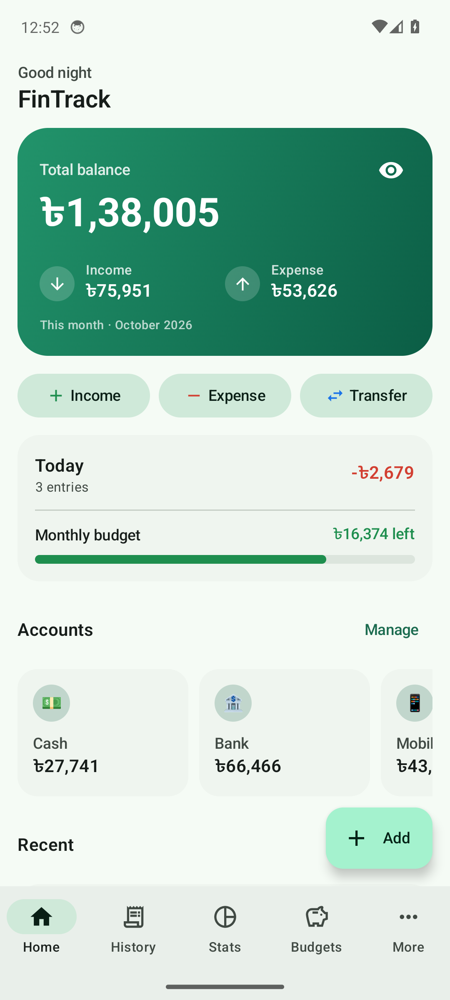
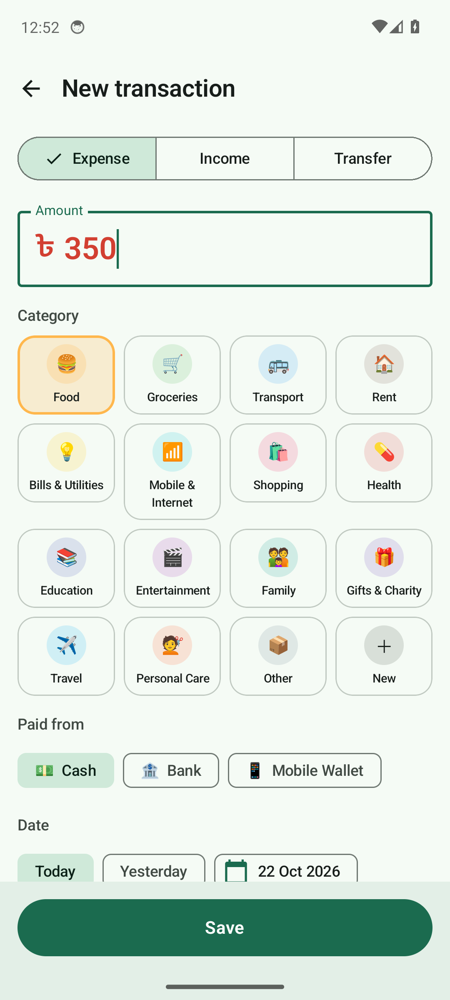
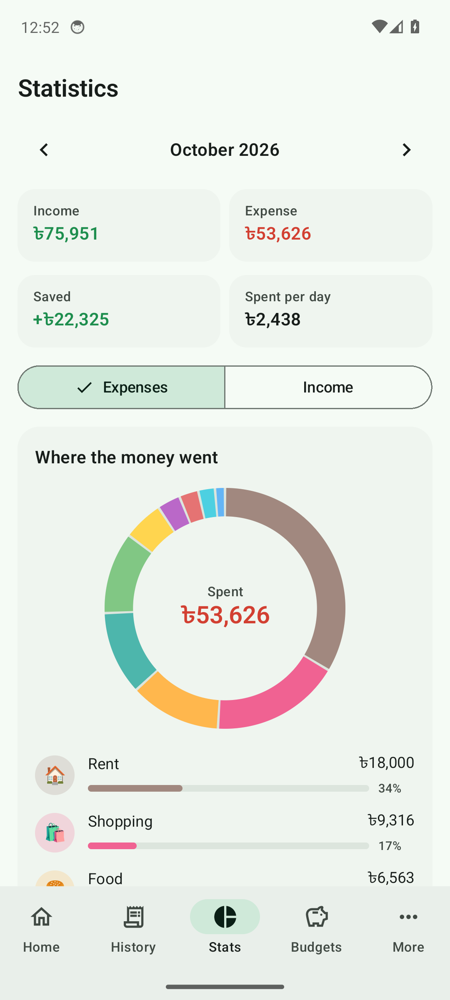
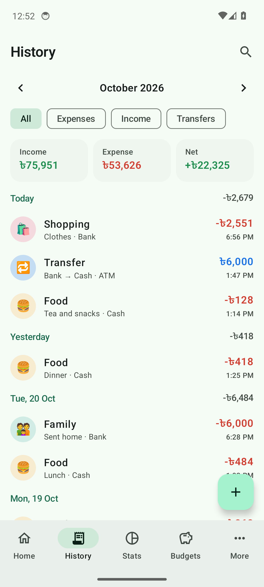
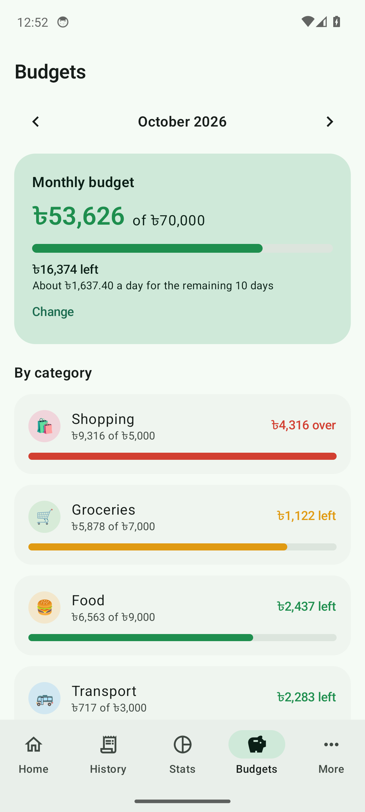
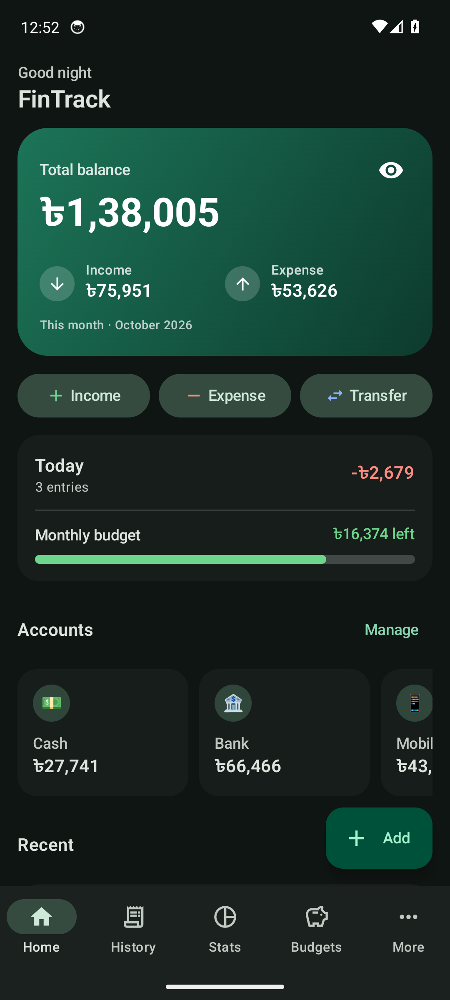

# FinTrack

A daily income and expense tracker for Android, with a matching web app. Record what comes in and what goes out in a few taps, and see where the money went. The phone app works fully offline. If you sign in with Google, the same records also appear in the web app, and changes on either side reach the other in seconds.

**[Download the latest APK](https://github.com/ocpabdurrahim/fintrack-android/releases/latest)** (Android 8.0 or newer) · **[Open the web app](https://fintrack-854d7.web.app)**

| Home | Add | Statistics |
|---|---|---|
|  |  |  |
| **History** | **Budgets** | **Dark theme** |
|  |  |  |

*The screenshots are taken automatically by CI on an Android 14 emulator, using sample data.*

## Features

- **Fast entry:** income, expenses and transfers between accounts. The amount field opens ready to type, and categories are one tap.
- **Home:** total balance, this month's income and expense, today's spending, budget left, recent entries.
- **History:** month by month and grouped by day, with filters. Search covers every note and category.
- **Statistics:** spending (or income) by category as a ring chart, a six-month income-vs-expense trend, and daily spending for the month.
- **Budgets:** an overall monthly limit plus per-category limits, with "about ৳X a day left".
- **Accounts:** cash, bank, bKash/Nagad or anything else, each with a starting balance.
- **Categories:** your own names, any emoji, your colours. Categories that are still in use get archived rather than deleted.
- **Recurring entries:** daily, weekly, monthly or yearly. Rent and salary get added on their own, even if the app was closed that day.
- **Sync with the web:** optional. Sign in with Google under **More → Sync**; the web app at [fintrack-854d7.web.app](https://fintrack-854d7.web.app) shows the same data, live.
- **App lock:** a 4-digit PIN with optional fingerprint/face unlock.
- **Daily reminder** notification at a time you pick.
- **Your data, portable:** back up to a JSON file and restore it on any phone, or export to CSV for Excel and Google Sheets.
- **Local formats:** Taka (৳) by default with 12,34,567 digit grouping, plus 20 other currencies and international grouping.
- Light and dark themes, wallpaper colours on Android 12+, and launcher shortcuts ("Add expense", "Add income").

## Tech

| Layer | What |
|---|---|
| Android UI | Kotlin, Jetpack Compose, Material 3, Navigation Compose |
| Android data | Room (SQLite) with Flow queries; DataStore for settings |
| Sync | Firebase Auth (Google sign-in via Credential Manager) and Cloud Firestore |
| Web | React, TypeScript, Vite; Firestore with a local browser cache; Firebase Hosting |
| Background | WorkManager for the daily reminder and recurring entries |
| Money | Integer minor units (paisa/cents) everywhere, so totals are always exact |

```
app/src/main/java/io/github/ocpabdurrahim/fintrack/
├── data/      Room entities, DAOs, migrations, repository, settings, backup/CSV
├── domain/    money formatting, dates, statistics, recurrence, PIN
├── sync/      Google sign-in and the phone <-> Firestore sync engine
├── system/    reminders (WorkManager), biometrics, launcher shortcuts
└── ui/        Compose screens
web/src/
├── data/      Firestore store (cache-first, live updates), types, starter data
├── domain/    the same money, date, statistics and recurrence rules as the phone
└── ui/        React pages and dialogs
```

How the two apps share data — ids, tombstones, conflicts, recurring entries — is
written down in [docs/sync-protocol.md](docs/sync-protocol.md).

## Building

Every push is built by GitHub Actions:

- [`build.yml`](.github/workflows/build.yml), for Android:
  1. Unit tests and the debug and release APKs.
  2. An Android 14 emulator run against local Firebase emulators. The UI tests add, transfer, delete and lock; a sync test checks phone-to-cloud, cloud-to-phone and deletes both ways; a migration test upgrades a 1.0.0 database; a screenshot tour runs; and the minified release APK is smoke-tested.
  3. Pushing a tag such as `v1.1.1` publishes a GitHub release with the signed APK.
- [`web.yml`](.github/workflows/web.yml), for the web app: type-check, unit tests and a production build.

Locally:

```bash
./gradlew assembleDebug
```

```bash
npm --prefix web install
```

```bash
npm --prefix web run build
```

```bash
npx firebase-tools deploy --only hosting,firestore:rules
```

The Android build needs `app/google-services.json`, which is not in the repository. CI writes it from the `FIREBASE_GOOGLE_SERVICES` secret, or uses `app/google-services.demo.json`, which works only with the Firebase emulators. To develop the web app against local emulators, run `npx firebase-tools emulators:start` and `npm --prefix web run dev:emulator`.

Release builds are signed with the key from the `FIN_KEYSTORE_*` repository secrets. Without them a local release build falls back to the debug key, and that APK cannot update one installed from the Releases page.

## Data and privacy

On the phone, everything lives in the app's private database, and the app works the same with or without signing in. If you turn on sync, your records are also stored in this project's Cloud Firestore database under your Google account. Security rules allow only you to read or write them. Theme, PIN lock and reminders are never uploaded.

Use **More → Back up** now and then, and keep the file somewhere safe. Uninstalling the app deletes the phone's copy; a synced cloud copy stays.
